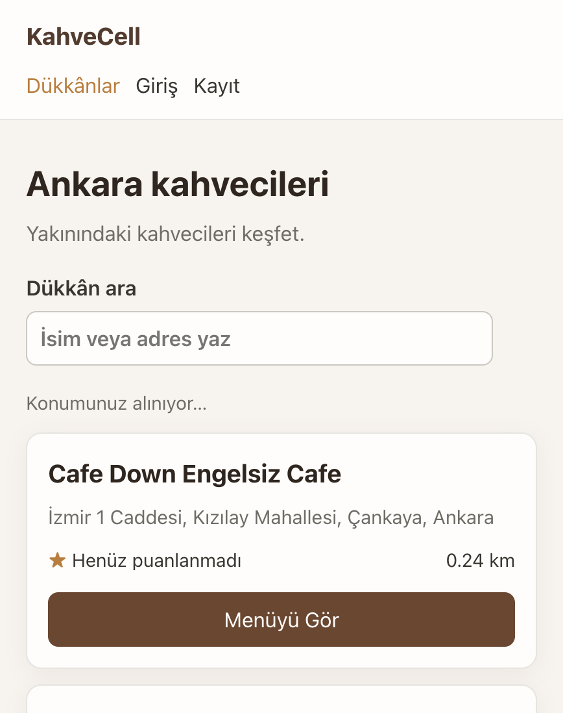
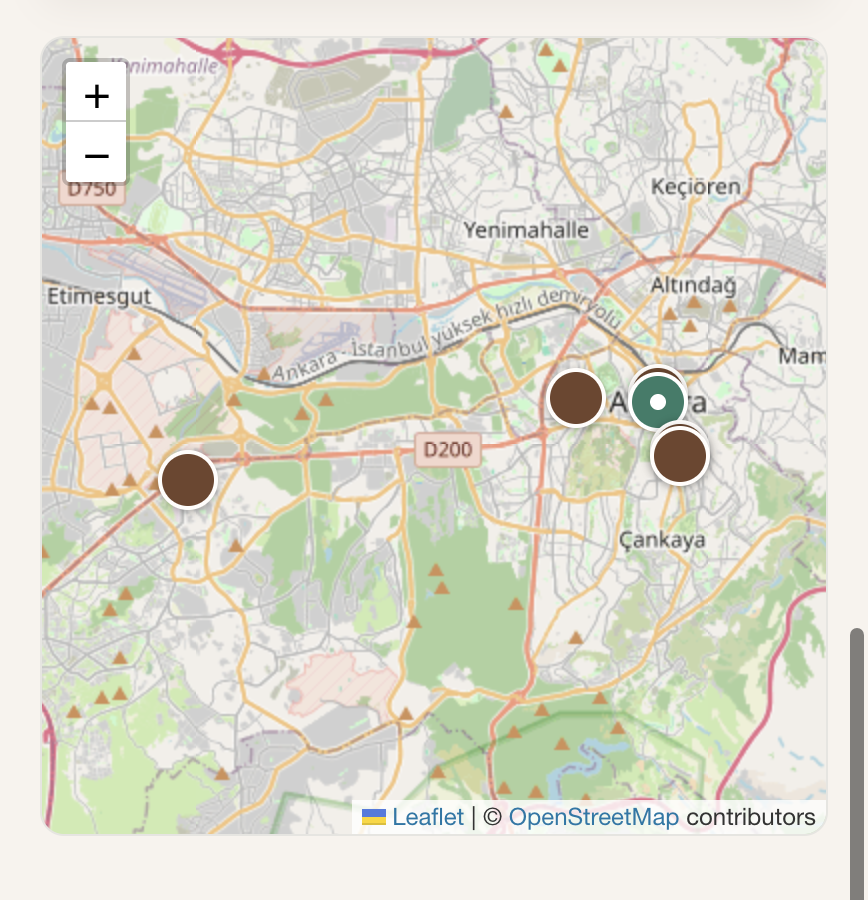
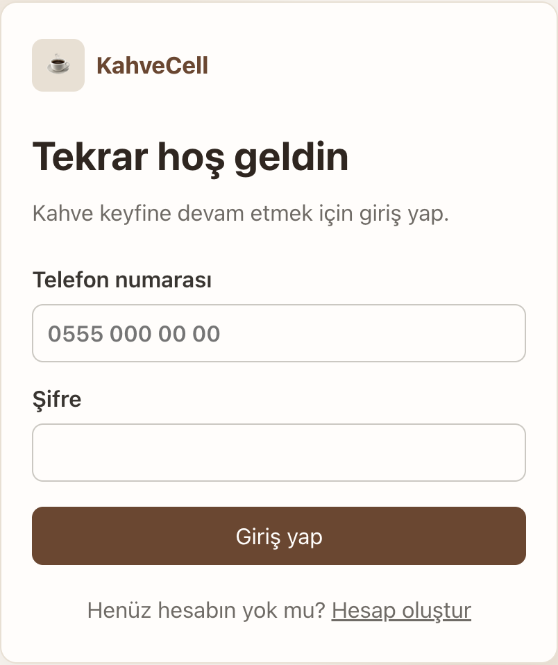

# KahveCell

KahveCell; kullanıcıların yakındaki kahvecileri keşfetmesini, abonelik paketiyle
kahve siparişi vermesini ve siparişini QR kodla teslim almasını sağlayan bir
kahve sipariş platformu demo uygulamasıdır.

> Bu proje, Turkcell Prompt Mühendisliği eğitimi kapsamında, uygulama fikrini
> küçük ve doğrulanabilir adımlara bölen prompt'larla geliştirilmiştir. Her
> aşamada istekler netleştirilmiş; önce backend ve API, ardından React
> arayüzü, sipariş akışları, gerçek zamanlı bildirimler ve Docker paketlemesi
> ele alınmıştır. Yapay zekâ bir geliştirme yardımcısı olarak kullanılmış,
> ortaya çıkan kod ve akışlar test edilerek ilerlenmiştir.

## Uygulamada neler yapılabilir?

- Telefon numarası ve şifreyle kayıt/giriş; SMS yerine kullanılan test OTP'si.
- Ankara'daki kahvecileri listede ve Leaflet haritasında görüntüleme.
- Konuma göre yakındaki dükkânları sıralama ve isim/adres araması.
- Dükkân menüsünü inceleme ve içeceği boyut, süt, şeker ve ek shot ile
  özelleştirme.
- Starter, Premium ve Unlimited aboneliklerini görüntüleme ve test ödeme
  simülasyonuyla satın alma.
- Kahve kredisi uygunsa sipariş oluşturma ve imzalı QR kod alma.
- Sipariş durumunu müşteri ekranında canlı takip etme.
- Dükkân sahibi hesabıyla siparişleri yönetme ve hazır siparişin QR kodunu
  doğrulayarak teslim etme.
- Sipariş geçmişini görüntüleme.

## Ekran görüntüleri

**Dükkânları keşfet ve arama**



**Leaflet haritasında dükkân konumları**



**Müşteri girişi**



## Adım adım deneme

### 1. Uygulamayı başlat

Docker Desktop çalışırken proje klasöründe:

```sh
docker compose up --build
```

- Web uygulaması: http://localhost:8080
- Backend API belgeleri (Swagger): http://localhost:8001/docs

İlk açılışta Ankara demo dükkânları ve test hesapları oluşturulur.

### 2. Dükkânları keşfet

Ana sayfayı aç. Konum izni verirsen yakındaki dükkânlar konumuna göre sıralanır;
izin vermezsen Ankara Kızılay varsayılan konum olarak kullanılır. Arama kutusuna
dükkân adı veya adres yazarak sonuçları daraltabilir, haritadaki işaretlere
tıklayarak dükkân bilgilerini görebilirsin.

### 3. Müşteri hesabıyla giriş yap

Yerel demo müşterisi:

- Telefon: `05550000000`
- Şifre: `KahveTest2026!`

Yeni bir hesap oluşturuyorsan OTP doğrulama ekranındaki test kodu `1234`'tür.

### 4. Menüden kahve seç ve sipariş ver

Bir dükkânda **Menüyü Gör** seçeneğine bas, ürünü ve boyut/süt/şeker/ek shot
tercihlerini belirle. Sipariş onayında aktif aboneliğin bulunmalı ve kahve
kredin yeterli olmalı.

### 5. Aboneliği dene

Abonelik sayfasından Starter, Premium veya Unlimited paketini seç. Ödeme
simülasyonu için test kartı `4242-4242-4242-4242` kullanılabilir. Ödeme başarılı
olduğunda paket ve kredi bilgisi güncellenir.

### 6. Siparişi takip et ve teslim al

Sipariş oluşturulduğunda QR ekranı açılır; durum değişiklikleri ekranda canlı
güncellenir. Dükkân sahibi ekranında siparişi Kabul Edildi → Hazırlanıyor →
Hazır adımlarıyla ilerlet. Test dükkân sahibi hesabı:

- Telefon: `05550000002`
- Şifre: `DukkanTest2026!`

Hazır siparişin QR kodunu doğrulayınca teslim tamamlanır. Bu demo hesapları ve
ödeme bilgileri yalnızca yerel test içindir.

### 7. Geçmiş siparişlere bak

Sipariş geçmişi sayfasında önceki siparişlerini tarihe göre yeniden eskiye
doğru görebilirsin.

## Teknoloji yığını

- **Backend:** Python, FastAPI, SQLAlchemy, SQLite
- **Frontend:** React, Vite, React Router
- **Harita:** Leaflet
- **Canlı sipariş durumu:** Server-Sent Events (SSE)
- **Paketleme:** Docker Compose, Nginx

## Docker komutları

Arka planda başlatmak için:

```sh
docker compose up --build -d
```

Durdurmak için:

```sh
docker compose down
```

SQLite veritabanı `kahvecell_data` adlı Docker volume'unda saklanır ve
container'lar kaldırılsa da korunur. Veritabanını ve demo verilerini tamamen
sıfırlamak için aşağıdaki komut volume içindeki verileri de siler:

```sh
docker compose down -v
```

İmzalama anahtarı yalnızca yerel geliştirme içindir. Dağıtım öncesinde
`JWT_SECRET_KEY` ortam değişkenini güvenli, rastgele bir değerle ayarla.
